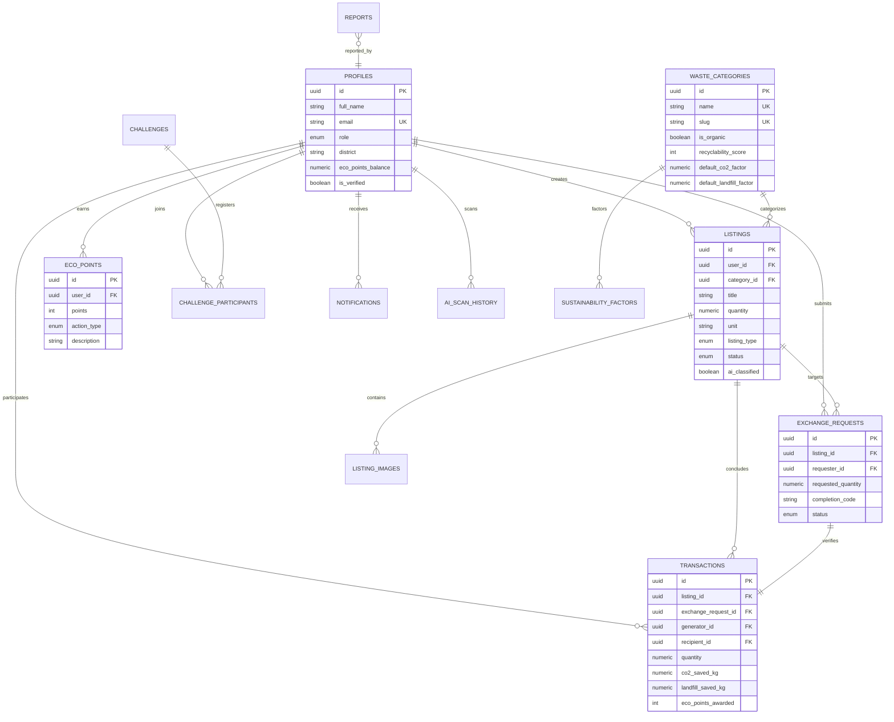

# GREENLOOP — Waste Has a Second Life 🌿

> **Theme**: Green Tomorrow – Building a Sustainable Future  
> **Competition**: TERRACODE 2026, FOSS Club, MEA Engineering College, Perinthalmanna, Kerala  
> **Submission Deadline**: 8 November 2026  
> **Repository**: Public Open Source under MIT License  

---

## 1. Project Overview

**GreenLoop** is an AI-powered, community-driven circular economy and waste exchange platform designed specifically for Kerala, India (scalable nationwide). Rather than a passive environmental awareness site, GreenLoop is a functional digital ecosystem that solves real waste-management bottlenecks by connecting:

- **Households**: Discard dry paper, packaging, glass, and sorted clean recyclables.
- **Commercial Waste Generators**: Restaurants, bakeries, hotels, and markets with surplus organic biomass.
- **Farmers & Gardeners**: Procuring composting feed, fruit residues, and coconut husk mulch for soil amendment.
- **Certified Secondary Recyclers**: Facilities (including **Haritha Karma Sena** and **Clean Kerala Company**) collecting bulk plastics, scrap metals, and e-waste.
- **NGOs & Educational Campuses**: Mobilizing clean-up drives, campus electronics recovery, and community challenges.
- **Platform Administrators**: Superadmin oversight, content moderation, and cryptographic audit logs.

---

## 2. Real-World Circular Scenario Walkthrough

GreenLoop provides the complete end-to-end operational lifecycle:

1. **Listing**: Malabar Kitchen in Perinthalmanna uploads a photograph of 25 kg pre-consumer vegetable cutoffs.
2. **AI Classification**: Google Gemini Vision identifies high-nitrogen biomass, assigns a 96.4% confidence score, and suggests **composting**.
3. **Smart Matching**: The algorithmic matchmaker alerts nearby organic farmer **Veda Organics** in Ottapalam with a **95% compatibility score**.
4. **Exchange Request**: The farmer submits a request detailing transport timing and compost bed application.
5. **Approval**: The restaurant accepts the request, generating a unique 6-character cryptographic pickup verification code (`GL-8924`).
6. **Handover & Verification**: Upon physical collection, the farmer presents the code to the restaurant.
7. **Empirical Telemetry**: The platform marks the batch complete, writes to immutable transaction logs, calculates **45.0 kg of avoided CO₂e**, and credits EcoPoints to both participants.
8. **Dashboard Update**: Community impact graphs update dynamically across Kerala's district networks.

---

## 3. Database Architecture & ER Diagram

The database is built on **PostgreSQL / Supabase** with Row Level Security (RLS), custom triggers, and audit logging across **16 tables**:



---

## 4. Key Feature Matrix

| Feature | Description | Implementation Status |
| :--- | :--- | :---: |
| **1. User Authentication** | Supabase Auth, role-based authorization, multi-persona switcher for evaluation | **Complete** |
| **2. Waste Marketplace** | Filter by Kerala district, 8 waste categories, free/exchange/sale options | **Complete** |
| **3. AI Waste Scanner** | Gemini multimodal vision classification, recyclability score, safety guidance, 1-click list | **Complete** |
| **4. Smart Matching** | Algorithmic scoring (Category 40%, Distance 30%, Quantity 15%, Impact 15%) | **Complete** |
| **5. Exchange Management**| Request submission, acceptance, 6-digit pickup code verification, handover completion | **Complete** |
| **6. Impact Dashboard** | Real-time carbon mitigation & landfill volume saved using KSPCB/IPCC metrics | **Complete** |
| **7. EcoPoints Rewards** | Cryptographically audited point ledger, badges, and Kerala community leaderboard | **Complete** |
| **8. Interactive Map** | Leaflet + OpenStreetMap displaying Haritha Karma Sena hubs & active waste pins | **Complete** |
| **9. Community Hub** | Campus & regional sustainability drives, progress bars, Kerala waste guides | **Complete** |
| **10. Admin Console** | Listing moderation, user registry, certified facility approvals, audit trail logs | **Complete** |

---

## 5. Technology Stack

- **Frontend**: React 19, TypeScript, Vite, Tailwind CSS, React Router v7, Framer Motion, Lucide React
- **Backend & Database**: Supabase (PostgreSQL, Supabase Auth, Storage, Row Level Security, Triggers)
- **AI Classification**: Google Gemini 1.5/2.5 Flash Vision API (with intelligent zero-key fallback)
- **Mapping**: Leaflet, React-Leaflet, OpenStreetMap
- **Data Visualization**: Recharts
- **Testing**: Vitest, React Testing Library
- **Design Palette**: Forest Green (`#174D36`), Lime (`#B6D96B`), Sage (`#A8C5A2`), Off-White (`#F7F9F5`)

---

## 6. Local Setup and Demonstration

### Prerequisites
- Node.js `v20.0.0` or newer (Tested on Node `v24.18.1`)
- npm `10+` or `11+`

### Step 1: Install Dependencies
```bash
npm install
```

### Step 2: Configure Environment Variables
Copy `.env.example` to `.env`:
```bash
cp .env.example .env
```
*(GreenLoop comes equipped with intelligent fallback data and vision classifiers so the entire application and demo scenarios work out-of-the-box without requiring live API keys immediately!)*

### Step 3: Run Development Server
```bash
npm run dev
```
Open your browser at `http://localhost:5173`.

### Step 4: Run Test Suite
```bash
npm run test
```

---

## 7. Supabase Database Setup (For Production Deployment)

1. Open your Supabase Project Dashboard at [supabase.com](https://supabase.com).
2. Navigate to the **SQL Editor**.
3. Execute the schema migration file located at:  
   `supabase/migrations/20261104000000_greenloop_schema.sql`
4. Execute the seed data script located at:  
   `supabase/seed.sql`
5. Copy your **Project URL** and **Anon Key** into your `.env` file.

---

## 8. Public GitHub Readiness Checklist

- [x] Public repository with clear open-source MIT License
- [x] Zero hardcoded secrets, passwords, or service-role API keys in source code
- [x] `.env.example` provided with documented configuration keys
- [x] Complete PostgreSQL database migration SQL and realistic Kerala seed data included
- [x] Passing Vitest test suite (8/8 unit and integration tests passing)
- [x] Production build passes clean TypeScript check (`npm run build`)
- [x] Responsive layout optimized for desktop, tablet, and mobile screens
- [x] Dedicated to **TERRACODE 2026** (FOSS Club, MEA Engineering College, Perinthalmanna)

---

## 9. Licence
This project is licensed under the **MIT License** — see the [LICENSE](LICENSE) file for details.
